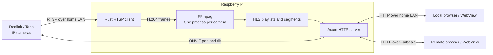
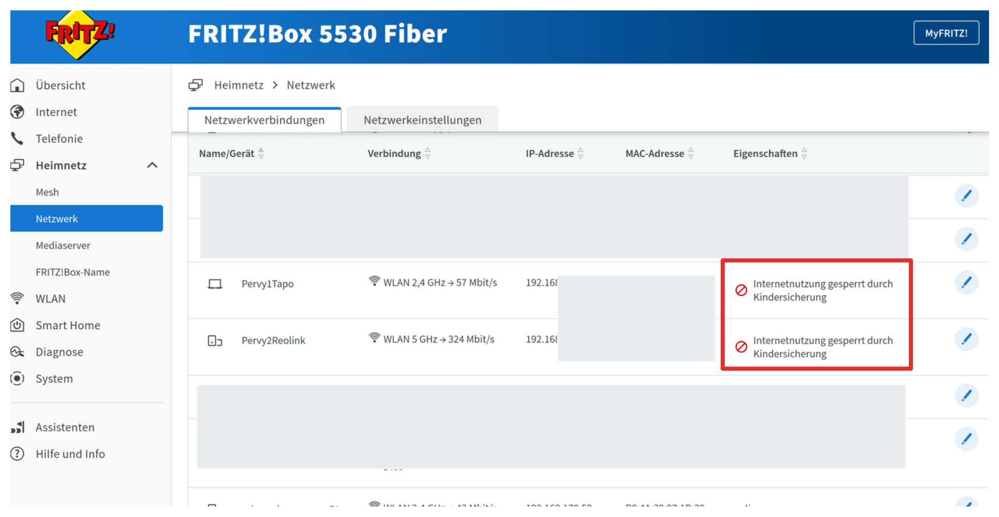

# IP Camera Home Security Setup `rioting` for more Privacy

A small Rust server for viewing RTSP streams from Tap/Realonk IP cameras in a simple web UI.

It avoids using the vendor apps which come with the comeras - They often forward the stream to through their servers before it appears on your phone/browser. We don't like that :)

## Architecture

The Rust server opens an RTSP session for each camera and pipes its H.264 frames to a dedicated FFmpeg process. FFmpeg packages the video as HLS without re-encoding and writes a rolling playlist and segments to disk. Axum serves the static UI, camera list, and HLS files. When a viewer uses the pan and tilt controls, Axum forwards the request to the camera over ONVIF.



The video path stays between the cameras, the Pi, and the viewer. The web UI currently loads hls.js from a CDN for browsers that need it for HLS playback.

## Background

Vendor apps can relay camera streams through the vendor's servers, especially when you watch away from home. This project gives you a direct viewing path. The Raspberry Pi pulls streams from cameras on the home network and serves live video to a simple web UI. At home, open the Pi's LAN address. Away from home, connect to Tailscale and open the Pi's Tailscale address.

Add a camera by adding a `[[cameras]]` entry to `config.toml`. The server uses the selected vendor to choose the RTSP stream path and default ONVIF port.

## Implementation Steps

- [x] Read RTSP stream from 1 (Tapo) camera with ffmpeg
- [x] Add Axum server
- [x] Serve received video from server with HLS in a simple webview.
- [x] Allow adding multiple cameras with `config.toml`
- [x] Suport Reolink cameras
- [x] Add ONVIF controls for cameras that support pan and tilt
- [x] Add Raspberry Pi deployment and a systemd service
- [x] Setup Tailscale

Future plans:

- [ ] Support WebRTC to support real-time steering
- [ ] Add upload functionality to cloud
- [ ] Connect to motion sensor 
- [ ] Triggger upload on motion while away from home

## Folder structure

```text
.
├── src/                    # Rust server, RTSP ingest, HLS output, and ONVIF control
├── static/
│   └── index.html          # Live camera view and pan/tilt controls
├── deploy/
│   └── rioting.service     # systemd service for the Raspberry Pi
├── config.example.toml     # Camera configuration template
├── Makefile.example        # Cross-build and deployment commands
└── Cargo.toml              # Rust package and dependencies
```

## Requirements

- Rust for building the server
- FFmpeg on the machine running the server (`sudo apt install ffmpeg` on Debian-based systems)
- Reolink or Tapo cameras with an H.264 RTSP stream and ONVIF access
- Tailscale on the Pi and the viewing device for remote access

## Camera setup

Find each camera's IP address in your router's connected devices list and reserve it so the address stays the same. In the camera settings, enable local RTSP and ONVIF access where your model exposes those options. Use the camera's local credentials in `config.toml`. The server connects over ONVIF during startup, including for cameras used only for viewing.

## Configuration

Copy `config.example.toml` to `config.toml` and fill in the camera settings.

```toml
server_port = "3000"

[[cameras]]
vendor = "tapo"
name = "front-door"
ip = "192.168.1.20"
user = "your-camera-user"
password = "your-camera-password"
```

Repeat the `[[cameras]]` block for each camera and give each one a unique name. Set `vendor` to `tapo` or `reolink`. Add `onvif_port` to a camera block if it uses a port other than the default for its vendor. `config.toml` is gitignored because it contains camera credentials.

## Deploying to a Raspberry Pi (or any dedicated server running Linux)

Copy `Makefile.example` to `Makefile` and set `PI_HOST` to your SSH destination. The example targets 64-bit ARM Linux. It uses `cross` when available and falls back to Cargo. With plain Cargo, install the Rust target and configure the cross-linker for your build machine.

Copy `config.toml` to the Pi. The supplied service runs as `ubuntu` and expects `config.toml` and the deployed `static/` directory in `/home/ubuntu`. Adjust the service and deployment paths to match if you use a different account.

```bash
make deploy-service
make deploy
```

Run `make deploy-service` on the first deployment or after changing the service file. Run `make deploy` to build and copy the binary and web UI, then start the service.


## Running locally

```bash
cargo run -- --config-path config.toml
```

Open `http://localhost:3000` on the server or `http://<pi-lan-ip>:3000` from another device on your home network. Use the port from `config.toml` if you changed it.

## Remote access with Tailscale

1. Install Tailscale on the Raspberry Pi and connect it to your tailnet. Open the sign-in link printed by `tailscale up`. [Tailscale Linux setup](https://tailscale.com/docs/install/linux)

   ```bash
   curl -fsSL https://tailscale.com/install.sh | sh
   sudo tailscale up
   ```

2. Get the Pi's Tailscale IPv4 address.

   ```bash
   tailscale ip -4
   ```

3. Install Tailscale on your phone or laptop and sign in to the same tailnet. [Tailscale downloads](https://tailscale.com/download)
4. With rioting running on the Pi and Tailscale connected on your viewing device, open `http://<pi-tailscale-ip>:3000`. Replace `3000` with your configured port if needed. To test from outside your home network, turn off Wi-Fi on your phone and try over mobile data.

The cameras stay on your home network. Tailscale runs on the Pi and the viewing device, so you can leave router port forwarding off.

## Disable the camera's access to the public internet

Depending on your Internet provider, you can disable a specific IP's access to the internet. I disabled the access to the internet for both my cameras at that time (here is an example in Fritz.Box):

